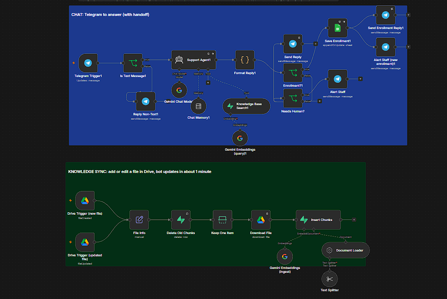

# AI Customer Support Bot with Human Handoff (n8n)

A Telegram support bot that answers **only from a company's own documents** and hands the chat to a human when it is not sure.

**Stack:** n8n · Google Gemini · Supabase (pgvector) · Google Drive · Telegram

## Problem
Support teams answer the same questions every day (fees, batches, refunds, policies). A normal chatbot can guess a wrong price. This bot is built so it does not guess.

## How it works
1. Staff add or edit a file in a Google Drive folder.
2. Within about a minute the old chunks of that file are deleted, and the new version is split, embedded and stored in Supabase.
3. A customer asks a question on Telegram.
4. The bot searches the documents, answers only from what it found, and shows the source file.
5. If the answer is missing, unclear or conflicting, the bot says so and alerts the staff.
6. **Enrollment:** when a student says they want to join a course, the bot asks for their name and mobile number, repeats the details, and waits for a YES. Then it saves the lead to Google Sheets (no duplicates), tells the student that the team will call, and alerts the staff with the details.

## Production-minded details
- Enrollment details are validated in code (phone number check, length limits, spreadsheet-formula protection), not left to the AI
- Repeated confirmations update the same row instead of creating duplicates
- Answers only from retrieved text, with exact numbers and a source file name
- Human handoff with a staff alert
- Auto re-indexing by file ID (no duplicate or outdated chunks)
- Retries on failures and a polite fallback message
- Handles non-text messages (photos, voice)
- Per-chat conversation memory
- Prompt-injection rules in the system prompt

## Setup
1. In n8n: **Workflows → ⋯ → Import from file**, choose `workflow/ai_support_bot_workflow.json`.
2. Add your own credentials: Telegram, Google Gemini, Supabase, Google Drive.
3. In Supabase, enable pgvector and create the `documents` table and `match_documents` function (standard n8n Supabase vector store setup).
4. Create a Google Sheet with a tab named `Enrollments` and these headers: `time, student_name, phone, course, telegram_chat_id, key, status`. Put its ID in **Save Enrollment**.
5. Set your Drive folder in both Drive triggers and your staff chat ID in **Alert Staff**.
6. Upload `docs/demo_handbook.md` content as a Google Doc into the folder, wait one minute, then message the bot.

## Demo questions
- "What is the fee for Data Analytics?"
- "I want to cancel on day 10 of Full-Stack. How much refund?"
- "Do you offer a placement guarantee?" (should hand off to a human)
- "I want to join Data Analytics" → give a name and number → reply YES (row appears in the sheet, staff get an alert)

## Notes
All company data in this repo is fictional. No credentials are included.
